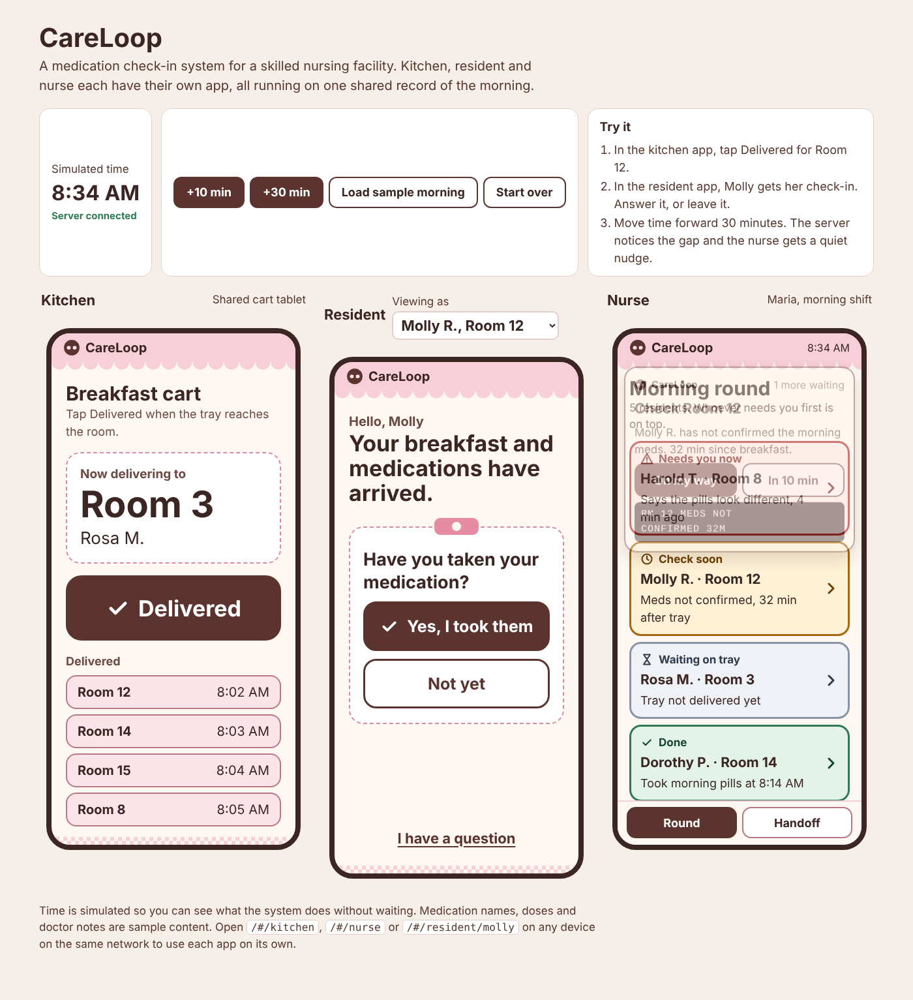

# CareLoop

CareLoop is a medication check-in and care-coordination prototype for skilled nursing facilities. It detects missed medication check-ins passively and alerts nursing staff in proportion to the urgency, so that residents who do not speak up are still noticed.


**Live demo:** https://your-address.onrender.com (the first load can take up to a minute because the free host sleeps when idle)

## Overview

In busy facilities, staff cannot be present for every resident at every moment, and residents who are accustomed to waiting often do not ask for help. CareLoop is built on one design principle:

> The system should not rely on a resident or a staff member initiating contact. It should detect gaps itself and respond in proportion: a quiet nudge, not an alarm.

The aim is to reduce how often a nurse must be physically present for a resident to be safe, while keeping the resident's independence.

## Features

| Application | Users | Capabilities |
| --- | --- | --- |
| Kitchen | Dietary staff | Confirms each tray delivery with a single action. Delivery starts the resident's check-in. |
| Resident | Residents | A one-question medication check-in with pictures of each pill, a short path for reporting a problem, and large, high-contrast controls. |
| Nurse | Nursing staff | A resident list ordered by urgency, a per-resident event timeline, quiet nudges with a matching pager-style text, and an automatically generated shift handoff log. |

**Passive detection.** If a resident has not confirmed their medication 30 minutes after their tray is delivered, the server records a nudge and sends it to the nurse. The nurse can respond, snooze for 10 minutes (the nudge returns if the gap persists), or confirm the medication was given. A resident who reports a problem is shown to staff as "Needs you now" immediately.

## Getting started

**Requirements:** Node.js 22.5 or later.

```bash
npm install
npm run dev
```

Open http://localhost:5173. The controls at the top of the page advance the simulated clock, load a sample morning, or reset the data.

Each phone on the page is an independent client with its own WebSocket connection to the same server. The applications can also be opened separately, for example on other devices on the same network:

- `/#/kitchen`
- `/#/nurse`
- `/#/resident/molly`

| Script | Description |
| --- | --- |
| `npm run dev` | Server on port 3001 and client on port 5173 |
| `npm start` | Builds the client and serves everything from port 3001 |
| `npm test` | Runs the test suite |
| `npm run typecheck` | Runs the TypeScript compiler without emitting output |

## Architecture

**Stack:** React, TypeScript, Node.js, Express, WebSockets, SQLite (`node:sqlite`), Vite, Vitest.

```
src/
  shared/domain.ts     Pure logic shared by server and clients: types, reducer, status rules, nudge detection
  server/service.ts    Business rules over SQLite, testable with an in-memory database
  server/index.ts      Express REST API and WebSocket broadcast
  client/              React applications and a single WebSocket hook
```

Key decisions:

- **Event sourcing.** The database stores an append-only list of events. Current state is computed by one pure reducer, which provides an audit trail and makes the shift handoff log a direct read of what happened.
- **Shared domain logic.** The server and clients import the same rules. The server rejects invalid actions (for example, confirming medication before a tray is delivered returns HTTP 409), and the clients use the same rules to decide what to display.
- **Server-side detection.** Nudges are created by the server as time passes, independent of any user action.
- **Derived alerts.** The set of active alerts is a function of current state, so alerts clear automatically when the situation changes.
- **Single data path.** Actions are sent over HTTP, and every resulting state change is broadcast as a snapshot over the WebSocket, so all clients converge on the same state.
- **Atomic writes.** Each action and the nudge detection that follows it are committed in one SQLite transaction.

### API

| Method and path | Description |
| --- | --- |
| `GET /api/state` | Returns the current snapshot (`{ clock, events }`) |
| `POST /api/events` | Applies an action: `{ type, residentId, reason? }`. Returns 400, 404 or 409 for invalid input |
| `POST /api/clock/advance` | Advances simulated time: `{ minutes }` |
| `POST /api/sample` | Loads a sample morning |
| `POST /api/reset` | Clears all data |
| `WS /ws` | Sends a full snapshot on connection and after every change |

## Design rationale

- **Recognition over recall.** Residents identify pills by picture and description instead of recalling names and doses.
- **Prospective memory support.** The check-in appears when the tray arrives, an event the resident already notices, rather than at a clock time.
- **Low social cost.** Reporting a problem takes a few plain taps and does not require calling for staff.
- **Proportional urgency.** Alerts are tiered (nudge, needs attention now, done) so that urgent items stand out and alert fatigue is reduced.
- **Accessibility.** Atkinson Hyperlegible typeface, large text, large touch targets, one task per screen, and status communicated by icon and label as well as color.

## Testing

`npm test` covers the domain rules (status transitions, nudge detection, snoozing, alert ordering and action validation), the service layer against an in-memory database, and the HTTP API.

## Limitations

- Time is simulated. Residents, medications and doctor notes are sample data.
- There is no authentication, role management or audit identity.
- No privacy or regulatory compliance work (for example HIPAA) has been done. The prototype must not be used with real resident data.
- The pager is an on-screen preview of a short text alert, not an integration with a real paging system.

## Roadmap

- Multiple medication times per day
- Per-resident escalation rules
- Charge-nurse view
- Push notifications and real pager integration
- Evaluation with nursing staff and residents
